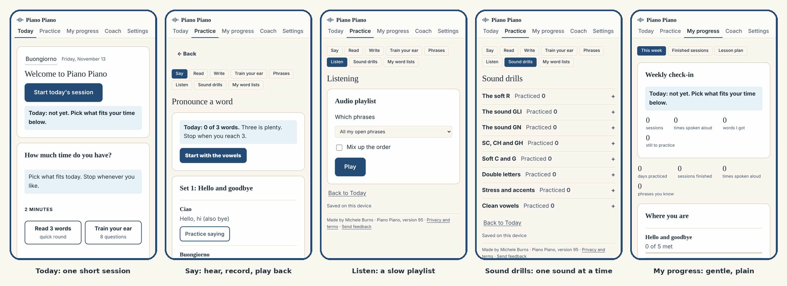
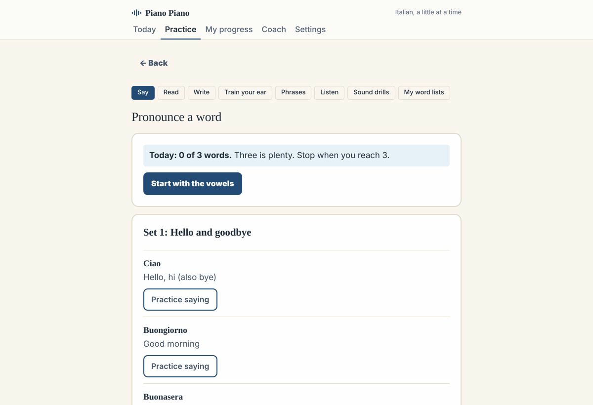

# Piano Piano

A gentle, one-step-at-a-time Italian tutor that runs in the browser. No account, no install, no server.

*Piano piano* means "slowly, slowly" in Italian. It was built by someone getting her Italian citizenship who has a learning disability that makes hearing, pronouncing and remembering new words hard, so every part is slow, calm and low pressure.

**Try it:** https://micheleburns74-prog.github.io/piano-piano-italian-tutor/app.html

## What it does

- **Reading first.** Reading can be easier than hearing for people with learning disabilities, so every phrase is shown on screen first, with its sounds spelled out and the stressed syllable in bold.
- **Hear, record, play back, rate.** Listen to a slow Italian male voice, record yourself, play your recording back, and rate it yourself (It matched, Almost, Not yet). The app never tells you that you said a word wrong.
- **Build words in small pieces.** When a word is hard, it walks through it one syllable at a time with a simple mouth cue, and can build it from the end backwards, then puts it back together.
- **Feel the sounds.** Tap the rhythm of each syllable, with a stronger tap on the stressed one. Sound tips use the body too, such as a hand on your throat to feel the hum of B, D, G, V and Z, and a single tongue tap for the Italian R.
- **Listen.** An audio playlist that says each phrase once, with a pause for you to repeat it. Play all your phrases, the newest set, or the shaky ones, in order or mixed up.
- **Sound drills** for tricky sounds such as the single R, double letters and "gli", with a sound of the week.
- **Memory tricks.** Each phrase has a starter picture or sound-alike trick, and you can write your own.
- **Short daily sessions** with spaced repetition (a Leitner box schedule) and a plain-language progress view.
- **Twelve sets of everyday phrases**, including offices, documents and numbers, opened a few at a time.

## The tabs

- **Today:** a short daily session that picks what to do next.
- **Practice:** Say, Read, Write, Train your ear, Phrases, Listen, Sound drills and My word lists.
- **My progress:** this week, finished sessions and the lesson plan.
- **Coach:** gentle guidance on what to work on.
- **Settings:** voice and speed, text size and layout, reminders and a backup of your progress.

## Privacy

- Everything runs in your browser. There is no account.
- Your recordings stay on your own device and are never uploaded.
- Your progress is saved in the browser's local storage. You can save and restore a backup file in Settings.
- Speech uses the Italian voices built into your device. If your device's voice does not start, the app can fall back to an online Italian voice, which sends only the phrase text (never your recording) to Google to be spoken.

## Run it

Open the link above on your phone or computer. The browser will ask for microphone permission when you tap Record.

## Built with

Plain HTML, CSS and JavaScript. No frameworks or libraries. The outside requests are the page fonts from Google Fonts and, only as a fallback, the online voice.

Built with Claude.

## License

Copyright (c) 2026 Michele Burns. All rights reserved. See `LICENSE`.
